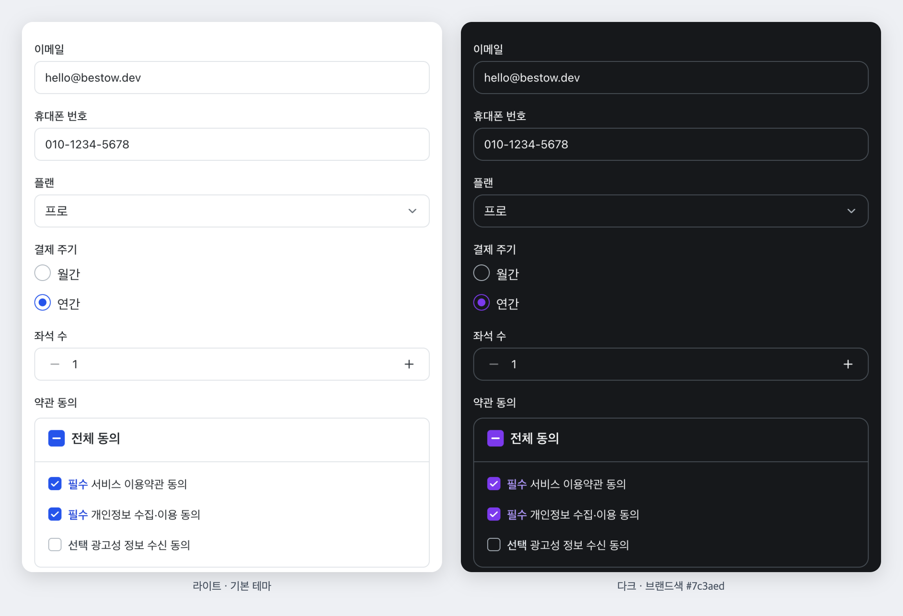

# BestOW UI

[](https://www.npmjs.com/package/@bestow-ui/react)
[](https://github.com/Dev-BestOW/BestOW-UI/actions/workflows/ci.yml)
[](LICENSE)

**한국 서비스를 만들 때 바로 쓰는, 접근성이 검증된 React 디자인 시스템.**

> A React design system for Korean services, with accessibility verified in CI. Docs are in Korean.

대표색 하나로 내 브랜드 테마를 만들고, 약관 동의부터 인증번호·주소·날짜 입력까지 한국 서비스에 늘 필요한 부품을 기본으로 써요.



📖 **[Storybook 문서](https://dev-bestow.github.io/BestOW-UI/)** · **[Next.js 예제 앱](https://dev-bestow.github.io/BestOW-UI/playground/)** (위 화면은 예제 앱의 [회원가입](https://dev-bestow.github.io/BestOW-UI/playground/signup/)) ·
[테마 빌더](https://dev-bestow.github.io/BestOW-UI/?path=/story/foundations-theme-builder--builder) · [KWCAG 2.2 대응](https://dev-bestow.github.io/BestOW-UI/?path=/docs/accessibility-kwcag-2-2-%EB%8C%80%EC%9D%91--docs)

## 특징

- 🇰🇷 **한국 서비스 키트** — 약관 동의(전체 동의), 인증번호(문자 자동 채우기·남은 시간), 전화번호·사업자등록번호(검증 공식)·금액(“12만 5,000원” 읽기),
  주소(카카오 우편번호), 날짜(일요일 시작·공휴일 표시)·기간(빠른 선택). → [Storybook › Korean Kit](https://dev-bestow.github.io/BestOW-UI/?path=/docs/korean-kit-agreementgroup--docs)
- ♿ **검사로 증명하는 접근성** — 모든 스토리를 실제 브라우저(Chromium·WebKit·Firefox)에서 라이트·다크 두 테마로 axe 검사해요(CI).
  고대비 모드·320px 리플로·기본 글꼴 2배도 확인하고, KWCAG 2.2 33개 항목별 대응 근거와 검사가 실제로 찾아 고친 문제를 기록했어요.
- 🎨 **대표색 하나로 끝나는 테마** — 브랜드 색을 넣어도 글자 대비 4.5:1(hover 포함)·포커스 링 3:1 을 라이트·다크 모두 자동으로 지켜요.
- ⚡ **가볍고 서버 컴포넌트 친화적** — 런타임 CSS 0(vanilla-extract), Next.js App Router 지원, 쓰는 컴포넌트만 번들에 들어가요
  (Button 하나 약 1.5 kB, 모든 컴포넌트 CSS 를 합쳐도 약 10 kB — minify + brotli).
- 🌐 **한국어 기본, 다국어 가능** — 기본 문구는 한국어, `LocaleProvider` 로 영어 등으로 한 번에 바꿔요. 한글은 단어 단위로 줄바꿈.

## 다른 선택지와 비교

| | BestOW UI | [shadcn/ui](https://ui.shadcn.com/docs) | [Radix Themes](https://www.radix-ui.com/themes/docs/overview/getting-started) | [MUI](https://mui.com/material-ui/) |
|---|---|---|---|---|
| 쓰는 방식 | npm 패키지 (업데이트를 받음) | 컴포넌트 코드를 프로젝트에 복사 | npm 패키지 | npm 패키지 |
| 스타일 | 빌드된 CSS 파일 하나 (vanilla-extract, 런타임 CSS 0) | Tailwind CSS 필요 | CSS 파일 import | Emotion 이 실행 중에 CSS 생성(기본) |
| 한국 서비스 입력 (약관 동의·인증번호·전화·사업자번호·금액·주소) | **기본 제공** | 직접 구현 | 직접 구현 | 직접 구현 |
| 기본 문구 | **한국어** (`en` 묶음 포함) | 복사한 코드에서 직접 수정 | — | 영어, `koKR` 로캘 제공 |
| KWCAG 2.2 항목별 대응 근거 | **Storybook 문서로 제공** | — | — | — |
| 브랜드색을 넣었을 때 대비 | 4.5:1 자동 보장·테스트 | 직접 확인 | 직접 확인 | 직접 확인 |

> 2026-10-21 각 공식 문서 기준(— 는 문서에서 찾지 못함). 다른 라이브러리도 각자 접근성에 힘쓰고 있어요 — 이 표는 "한국 서비스를 만들 때" 기준의 차이예요.
> 틀린 내용이 있으면 [이슈](https://github.com/Dev-BestOW/BestOW-UI/issues)로 알려 주세요.

## 시작하기

```bash
npm install @bestow-ui/react
# pnpm add @bestow-ui/react / yarn add @bestow-ui/react
```

React 18 이상이 필요해요. 아이콘(`@bestow-ui/icons`)과 토큰(`@bestow-ui/tokens`)은 함께 설치돼요.

### Next.js 에서 5분 만에 시작하기 (App Router)

**1. Provider 를 `'use client'` 파일로 만들어요.**

```tsx
// app/providers.tsx
'use client';

import { ThemeProvider, ToastProvider } from '@bestow-ui/react';
import type { ReactNode } from 'react';

export function Providers({ children }: { children: ReactNode }) {
  return (
    <ThemeProvider theme="light">
      <ToastProvider>{children}</ToastProvider>
    </ThemeProvider>
  );
}
```

**2. 레이아웃에서 스타일을 한 번 불러오고 감싸요.**

```tsx
// app/layout.tsx
import '@bestow-ui/react/styles.css';
import { Providers } from './providers';

export default function RootLayout({ children }: { children: React.ReactNode }) {
  return (
    <html lang="ko">
      <body>
        <Providers>{children}</Providers>
      </body>
    </html>
  );
}
```

**3. 컴포넌트를 써요.** 상태가 없는 표시용 컴포넌트(`Card`, `Typography`, `Stack` 등)는 서버 컴포넌트에서 그대로 렌더링돼요.

```tsx
// app/signup/page.tsx — 서버 컴포넌트
import { Card, Stack, Typography } from '@bestow-ui/react';
import { SignupForm } from './SignupForm';

export default function Page() {
  return (
    <Card>
      <Stack gap={4}>
        <Typography variant="h1">회원가입</Typography>
        <SignupForm />
      </Stack>
    </Card>
  );
}
```

```tsx
// app/signup/SignupForm.tsx
'use client';

import { AgreementGroup, Button, PhoneNumberInput, useToast } from '@bestow-ui/react';
import { useState } from 'react';

const agreements = [
  { value: 'terms', label: '서비스 이용약관 동의', required: true },
  { value: 'privacy', label: '개인정보 수집·이용 동의', required: true },
  { value: 'ads', label: '광고성 정보 수신 동의' },
];

export function SignupForm() {
  const [phone, setPhone] = useState(''); // 하이픈 없는 숫자만 ('01012345678')
  const [agreed, setAgreed] = useState<string[]>([]);
  const { toast } = useToast();

  return (
    <>
      <PhoneNumberInput value={phone} onValueChange={setPhone} required />
      <AgreementGroup label="약관 동의" items={agreements} value={agreed} onValueChange={setAgreed} />
      <Button onClick={() => toast({ title: '가입했어요', color: 'success' })}>가입</Button>
    </>
  );
}
```

react-hook-form 과 함께 쓰는 방법, 오류 요약(`ErrorSummary`)은 [화면 패턴](https://dev-bestow.github.io/BestOW-UI/?path=/docs/guides-%ED%99%94%EB%A9%B4-%ED%8C%A8%ED%84%B4--docs) 가이드에 있어요.
Next.js 가 아니어도 같아요 — 앱 진입점에서 `styles.css` 를 불러오고 `ThemeProvider` 로 감싸면 돼요.

### 다크 모드와 브랜드 테마

```tsx
import { ThemeProvider, createTheme, createIntentColors } from '@bestow-ui/react';

const brand = createTheme(
  createIntentColors('primary', '#7c3aed'), // 대표색 하나로 라이트·다크 색 세트 자동 생성 (대비 4.5:1 보장)
  { common: { radius: { md: '6px' } } },
);

<ThemeProvider theme={mode /* 'light' | 'dark' */} overrides={brand}>…</ThemeProvider>;
```

- `theme`(light/dark)과 `overrides`(브랜드)는 따로 동작해서, 모드를 바꿔도 브랜드는 유지돼요. Modal·Select·Toast 처럼 portal 로 띄우는 요소도 따라가요.
- CSS 변수 이름이 고정돼 있어서 CSS 로만 바꿀 수도 있어요: `:root { --bestow-color-primary-solid: #7c3aed; }`
  전체 목록은 Storybook **Foundations › Theming › CSS 변수**.
- 입력 칸·체크 컨트롤 테두리를 배경과 3:1 이상으로 진하게 하려면 `createTheme(brand, strongInputBorders)` 처럼 `strongInputBorders` 를 더해요(2.0 에서 기본값이 될 예정).

### 아이콘

```tsx
import { SearchIcon, TrashIcon } from '@bestow-ui/icons';

<SearchIcon />                         // 24px, 장식용(aria-hidden)
<TrashIcon size={16} strokeWidth={1.5} />
<SearchIcon title="검색" />             // 스크린리더가 읽는 아이콘
```

필요한 아이콘만 import 하면 그 아이콘만 번들에 들어가요. 기본 세트는 [Lucide](https://lucide.dev) 기반 57종이에요.

## 컴포넌트

| 분류 | 컴포넌트 |
|---|---|
| 한국 서비스 키트 | `AgreementGroup`(약관 동의), `VerificationCodeInput`(인증번호), `PhoneNumberInput`, `BusinessNumberInput`, `AmountInput`, `AddressInput`, `DatePicker`, `DateRangePicker`, `Calendar` + 서식 함수(`formatPhoneNumber`, `isValidBusinessNumber`, `formatKoreanAmount` 등) |
| 폼 | `Input`, `TextField`, `Textarea`, `Select`, `Combobox`, `NumberInput`, `FileUpload`, `Checkbox`, `RadioGroup`, `Switch`, `Slider` |
| 동작 | `Button`, `IconButton`, `Link` |
| 피드백 | `Alert`, `ErrorSummary`, `Progress`, `ToastProvider` + `useToast`, `Spinner`, `Skeleton`, `Badge` |
| 오버레이 | `Modal`, `Drawer`, `Popover`, `Tooltip`, `DropdownMenu` |
| 탐색 | `Tabs`, `SegmentedControl`, `Accordion`, `Pagination`, `Breadcrumb`, `SkipLink`, `Stepper` |
| 레이아웃·표시 | `Stack`, `Divider`, `Card`, `Typography`, `VisuallyHidden`, `Avatar`, `Table`(+ 선택·빈 상태·로딩), `DescriptionList` |
| 테마·문구 | `ThemeProvider`, `createTheme`, `createIntentColors`, `strongInputBorders`, `vars`, `LocaleProvider`, `en` |

모든 컴포넌트는 [Storybook](https://dev-bestow.github.io/BestOW-UI/)에서 직접 조작해 볼 수 있고, 키보드·스크린리더 동작도 컴포넌트마다 정리돼 있어요.
어떤 컴포넌트를 골라야 할지는 [언제 무엇을 쓰나](https://dev-bestow.github.io/BestOW-UI/?path=/docs/guides-%EC%96%B8%EC%A0%9C-%EB%AC%B4%EC%97%87%EC%9D%84-%EC%93%B0%EB%82%98--docs) 가이드를 보세요.

## 패키지

| 패키지 | 설명 |
|---|---|
| [`@bestow-ui/react`](packages/react) | 테마(ThemeProvider)와 React 컴포넌트 |
| [`@bestow-ui/tokens`](packages/tokens) | 색상·간격·타이포그래피 등 디자인 토큰 (원시 값) |
| [`@bestow-ui/icons`](packages/icons) | SVG 아이콘 React 컴포넌트 (기본 세트는 [Lucide](https://lucide.dev), ISC) |

## 지원 범위 · 보안

Chrome·Edge·Firefox·Safari 최근 2개 메이저 버전(모바일 포함), React 18·19, Next.js App Router 를 CI 로 확인해요.
버전 정책(semver·deprecated)과 배포 주기는 [SUPPORT.md](SUPPORT.md), 보안 문제 신고는 [SECURITY.md](SECURITY.md) 를 보세요.

## 참여하기

질문·아이디어는 [Discussions](https://github.com/Dev-BestOW/BestOW-UI/discussions), 버그는 [이슈](https://github.com/Dev-BestOW/BestOW-UI/issues)로 알려 주세요.
개발 환경·컴포넌트 추가 체크리스트·배포 흐름은 [CONTRIBUTING.md](CONTRIBUTING.md), 왜 이렇게 만드는지는 [docs/POSITIONING.md](docs/POSITIONING.md),
앞으로의 계획은 [docs/ROADMAP.md](docs/ROADMAP.md)에 있어요.

## 라이선스

[MIT](LICENSE) © Dev-BestOW. 단, `@bestow-ui/icons` 의 아이콘 그림은 Lucide 기반이라 [ISC](packages/icons/LICENSE) 예요.
